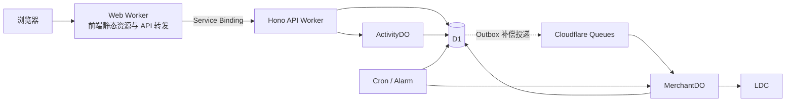

# Linux DO 奖励兑奖平台一期技术方案

本方案确定一期范围、技术架构、兑奖一致性和自动付款恢复机制，作为后续确定开发目标的依据，与[业务规格 v1](business-spec-v1.md)配合使用。

本文为已确认的技术方案基线，不代表全部业务功能已经实现或通过接入验收。账户、文本兑奖、发现、统计及三类金额的本地模拟已实现；普通真实活动已接入当前商户、凭证发布资格、真实领取任务和长期恢复，预发布与生产均已部署。2026-10-04 的本地独立验收以用户确认的 `100001 / Tester7369` 完成 0.10 LDC 发放、查单与一次同参数重复验证；这笔历史结果没有导入生产，实际证据与适用范围见[接入证据](ldc-integration-evidence.md)。生产已启用 `live`，本轮授权测试活动已有四名真实非作者领取，四笔普通真实付款均已确认，本轮限定的生产试运行闭环验收通过。用户已确认套餐升级，升级后的实际 Workers 配额与 CPU 预算、线上额度恢复、费用、净收款及结算可用时间仍保留未验证边界。逐步验证情况见[一期实施记录](implementation-phase-1.md)，工程启动与检查命令见[项目说明](../README.md)。

## 一、一期范围与技术栈

2026-10-05 远程进度：预发布和生产已经部署，TLS、Service Binding、私有 API、真实队列消费及四项 Cron 补偿有实际证据。兼容版本回滚和原地数据库恢复在预发布验收；生产付款后 SQL 导出及本地隔离恢复也已通过，生产原地恢复未执行。生产 `lafish` 登录、商户“1”重加密保存和版本 1 凭证检查通过；`live` 已生效，三个停止开关为 `false`，数据库控制版本 2 的三个许可为 1。本轮自动创建的授权测试活动 `aeb4a7c2-4cd9-4d2c-8314-abb88b7d93fb` 为 5 份 × 0.10 LDC，于 03:30:34.558 开放、次日同一时刻截止（Asia/Shanghai）；生产还有其他正常活动。开放后独立检查全部通过，03:32:16 为零领取、零付款任务的早期快照。09:46:03 快照及 09:54 复核确认目标活动已领取四份、四笔普通付款 `confirmed`，合计 0.40 LDC、剩余一份；每笔发送及查单各一次，使用版本 1 凭证及 `claim_same_order_v1`，唯一 Outbox 均已投递。Credit 后台对应订单和付款记录未见重复迹象，具体核对范围见接入证据；预发布文本闭环已通过。升级前Free稳定预算未通过，升级后实际预算待复测。

一期提供活动创建、口令兑换、文本奖励、作者商户直发、广场、帖子索引、个人记录和符合条件的尝试统计。

平台收款、平台代发、余额、提现、资金占用、结余释放及 12% 费率功能全部后移。现有业务规格保留这些完整产品规则，但明确标注为后续阶段。

新增两项已经确认的规则：

- **按商户应用 `client_id` 隔离付款调度。** 目前不宣称能够核实商户所属账号，也不宣称能够准确读取账号剩余额度。
- **作者不能领取自己创建的 LDC 活动。** 在分配奖励前拦截，文本奖励不增加此限制。由于无法核实实际商户归属，仍需处理 LDC 返回的其他自付拒绝。

技术栈确定为：

| 层次 | 选型与职责 |
|---|---|
| 前端基础 | React、TypeScript、Vite |
| 路由 | TanStack Router |
| 服务端数据 | TanStack Query |
| 表单 | TanStack Form、Zod |
| 本地状态 | Jotai，仅管理跨组件的临时交互状态 |
| 样式与交互 | Tailwind CSS、Motion、shadcn/ui、Lucide |
| 后端 | Hono、Cloudflare Workers |
| 数据库 | D1、Drizzle、Drizzle Kit |
| 并发协调 | Durable Objects |
| 后台任务 | Cloudflare Queues、Cron Triggers、DO Alarms |
| 接口契约 | `packages/contracts` 纯 Zod 校验、Hono RPC 类型共享 |
| 共享说明 | react-markdown 10.1.0，CommonMark；禁用 HTML、图片及危险协议 |
| 工程工具 | Bun workspace、Wrangler、Biome |
| 测试 | Vitest、Cloudflare Vitest 集成、Playwright |

Router 保存活动定位和列表筛选；Query 管理活动、库存、领取和付款状态；Form 管理表单。Jotai 不保存权威库存或付款结果。

一期采用轮询：可见页面默认每 15 秒刷新需要更新的数据，凭证检查中每 2 秒刷新；操作成功后立即刷新相关查询，付款确认后停止相应任务轮询。

## 二、部署、数据与扩展边界

**采用同仓库、前后端独立应用、同一公共域名。**

图中的 Outbox 投递由 Worker 读取 D1 后执行，队列消息由 Worker 消费入口转交 MerchantDO；D1 不主动发送消息。Cron 和 Alarm 通过对应 Worker 或 DO 的处理逻辑执行扫描与唤醒。

该图描述接入结构。MerchantDO 调用模拟或真实适配器前统一判断任务模式与授权；普通真实付款由生产 `live` 模式、环境停止开关、版本化数据库控制和真实领取关系共同授权，采用 `claim_same_order_v1`。本地独立验收仍使用原有许可，不能挪用到普通任务。首次验收发送许可的消费记录永久保留；其原号恢复要求固定参数、限时限次的授权，成功后的一次重复验证也使用独立许可。

Web Worker 托管 Vite 产物，将 `/api` 和 `/api/*` 通过 Service Binding 转交后端。认证回调也位于 `/api/` 下，避免被 SPA fallback 截获。

后端 Worker 关闭 `workers.dev` 和版本访问地址，不配置公共域名或路由；自身仍执行认证和权限检查。网关原样转交请求、响应和 Cookie，API 错误不能回退成前端 HTML。本地通过 Cloudflare Vite 插件的辅助 Worker 能力使用相同调用结构。

这一部署方式有 [Cloudflare SPA 路由](https://developers.cloudflare.com/workers/static-assets/routing/single-page-application/#advanced-routing-control)和 [Service Binding](https://developers.cloudflare.com/workers/runtime-apis/bindings/service-bindings/http/) 官方支持。后端配置需同时显式关闭 `workers_dev` 和 `preview_urls`，参见[版本地址配置](https://developers.cloudflare.com/workers/versions-and-deployments/version-urls/#enable-or-disable-version-urls)；本地开发参见[多 Worker 开发](https://developers.cloudflare.com/workers/local-development/multi-workers/)。

**D1 是业务事实的唯一持久来源。**

一期数据覆盖：

- 用户、登录会话。
- 活动、有效口令、预生成奖励库存、领取记录。
- 强制专属活动的校验事件与统计。
- 商户配置、凭证版本。
- 绑定凭证版本的检查结果与独立验收授权。
- 付款任务、付款尝试、商户暂停状态。
- 幂等请求和待投递事件 Outbox。

不提前建立空的钱包、充值、提现或资金流水表。

当前增量迁移 `0003` 增加全站提交快照及广场设置，`0004` 增加商户、凭证版本、付款／Outbox 和模拟上游数据，`0005` 增加未知付款标记，`0006_watery_psynapse.sql` 将 `text_inventory` 升级为 `reward_inventory` 并扩展活动付款配置。统一库存用约束区分加密文本与正整数最小单位金额，保留旧文本 ID、密文及领取外键；加密关联数据的活动／库存身份保持不变。迁移回归从已有领取的步骤 3 数据库升级，验证原文本仍可解密、外键完整及无重复分配。

DO 分为两类：

| 对象 | 标识 | 职责 |
|---|---|---|
| ActivityDO | 活动 UUID | 协调领取、结束及关键配置修改 |
| MerchantDO | LDC `client_id` | 协调该商户应用的发送、等待、查单与恢复 |

同一 `client_id` 在平台内只有一个商户配置和调度入口。配置管理者身份不等于已经验证的 LDC 商户所有者身份。

DO 内存不是正确性的最终保障。库存约束、发送占用和暂停原因必须持久化，重启后从 D1 恢复；不能在长时间网络请求或等待额度期间持有阻塞整个对象的临界区。

后续增加平台代发时，沿用领取记录、付款任务和外部订单关联，再新增资金来源、余额账本及开放前资金检查。现阶段不实现通用资金框架。

## 已实现的文本活动管理边界（步骤 2）

- 创建与编辑为单页分区，支持保存草稿或保存并自动检查凭证、开放；续接绑定当前页面与活动、商户、凭证版本。输入不进入 URL 或浏览器持久存储。创建使用作者与请求标识唯一约束及内容摘要，未知结果重试复用原请求。
- 管理详情与公开详情独立建模；先校验归属再解密，公开响应始终使用白名单。所有活动响应禁止缓存，退出清理私有查询。
- 创建原子写入活动、HMAC 口令索引及加密文本库存；后续修改和开放统一经过 ActivityDO。D1 同批次版本条件以约束失败触发整体回滚，避免旧草稿覆盖已开放的库存。
- 强制专属设置创建即冻结。开放后冻结库存及分配方式；关联帖子在全部生命周期可修改，精确保存主题和回复。口令最多追加到5条，历史超限集合保留；允许修改展示与说明、延长尚未结束的期限。
- 默认期限从成功开放计算；重复开放返回原时间。请求路径按实际截止时间派生结束／归档，步骤 3 已补充持久化补偿和手动结束。
- 共享契约统一上限：标题 100 字符、新活动 5 个口令（历史最多100独立兼容）、1,000 份文本库存、单份 16 KiB、单段说明 10,000 字符、请求正文 1 MiB。超限拒绝，不截断。字符数按 Unicode 码点、文本字节数按 UTF-8 计算。
- 模糊数量只返回等级：余量超过 50% 为充足、超过 20% 为有限、正数为少量、零为已领完。私有奖励不进行 Markdown 渲染。

## 文本领取与生命周期实现（步骤 3）

- `claims` 唯一约束每账号每活动、每活动每库存条目；使用活动与库存 ID 的复合外键。私有文本继续引用冻结库存，不复制明文。
- `redemption_submissions` 以账号与提交 UUID 唯一标识，绑定活动及规范化口令的 HMAC 摘要。重复请求恢复原流程或原结果，不能换活动／口令；非强制活动不保存失败口令原文。
- 强制专属活动将加密校验文本和提交时命中结果保存为独立 `attempt_events`；分配失败不会撤销已完成的校验事件。领取成功关联至唯一尝试，新增口令不追溯改变历史。
- 校验与分配分两次持久化：前者确认资格与限流并写校验事实，后者重新检查期限／库存，在原子批次内锁定奖励、写领取和计数、必要时结束活动。D1 条件与约束承担最终正确性，ActivityDO 通过显式队列串行协调短流程。
- 默认每账号每活动滚动 60 秒内最多 10 次实际校验，服务端环境变量 `CLAIM_ATTEMPTS_PER_MINUTE` 可调整；持久化校验时间保证 DO 重启不会清空计数。限流响应含 `Retry-After`。
- 专属页的本人奖励查询、我的领取及作者领取列表独立鉴权、禁止缓存；公共详情不混入领取后说明或奖励。公共名单游标加密，避免隐藏时间通过分页参数泄漏。
- 结束时间使用真实业务时刻：到期取截止时间，领完取最后一次分配时间，提前结束取成功时间；归档为结束后 72 小时。Cron 只把候选交给 ActivityDO，处理时重新核实当前期限，避免覆盖延期。
- Cron 同时唤醒已校验但未完成的提交；恢复仍检查当前库存与期限。普通领取仅更新数量，最后一份及其他生命周期变化推进活动版本。

## 三、兑奖、统计与接口边界

**先确定奖励，再异步付款。**

LDC 各份金额在活动开放前生成并保存，文本奖励逐条保存。金额使用整数最小单位计算和存储，输出时转换为两位小数字符串。

领取事务需要同时完成：

- 检查活动仍可领取、用户尚未领取，并满足作者不能自领 LDC 的限制。
- 分配唯一库存条目并保存领取记录。
- 更新数量，以及最后一份领取导致的结束状态。
- 更新对应尝试事件的成功领取关联（仅适用于提供尝试统计的活动）。
- LDC 奖励创建付款任务及 Outbox 事件。

数据库至少保证“一人一活动一份奖励”“一份库存只能分配一次”“一条领取记录只有一笔应付奖励”。

使用 D1 原子批处理和数据库约束实现上述保证。**条件更新影响零行不等于 SQL 失败**，必须通过同批次的约束检查使不满足条件的操作整体回滚，不能提交后才由 JavaScript 判断成功与否。也不假设 Drizzle 的通用交互式事务可以直接用于 D1。

参考：[D1 batch 事务语义](https://developers.cloudflare.com/d1/worker-api/d1-database/#batch)。

**校验事件与领取结果分别建模。**

错误口令、正确但未成功分配的口令同样可能需要统计，不能只在成功领取时写入尝试记录。

每次主动提交拥有唯一提交 ID；同一次网络重发复用该 ID，用户重新主动提交则使用新 ID。强制专属活动保存符合统计条件的校验事件，成功领取时再关联领取结果。新增口令不改写历史校验结果。

全站失败输入和普通活动的口令尝试不进入作者统计。浏览匹配列表、进入页面、查询原领取记录也不增加尝试数。

主要接口边界为：

| 接口能力 | 行为 |
|---|---|
| 全站兑奖提交 | 返回无匹配、单活动处理结果或多活动列表 |
| 指定活动领取 | 只校验并领取当前活动 |
| 活动及列表查询 | 按服务端权限返回允许展示的信息 |
| 我的领取查询 | 返回本人奖励及付款状态 |
| 商户重新检查 | 触发凭证检查或查单恢复，不能绕过未决付款保护 |
| 作者活动统计 | 仅允许作者查询强制专属活动 |

所有可能产生奖励分配的请求都需要幂等键，并校验同一键对应的请求内容一致。

多匹配继续遵循已确认的业务规则：

- 展示全部符合条件的活动。
- 点击卡片仅进入详情，确认领取才分配。
- 口令只在当前前端会话内保留，不进入 URL、持久化浏览器存储或日志。
- 返回匹配列表时刷新活动信息，不自动再次调用可能直接领取的全站提交接口。
- 同一次请求重试不能因为候选集合变化而自动换领另一活动。

### 已实现的全站提交与发现（步骤 4）

`POST /api/redemptions` 按账号与提交 UUID 保存请求摘要、首次候选 ID 集合、无／单／多结果及单活动的领取提交 ID。重复请求先读取原记录，不重新选择候选。`GET /api/redemptions/:id` 只允许提交者刷新原列表；过滤已归档活动后，即使只剩一个也不变为自动领取。单活动结果保留原目标 ID，后续到期或归档不能换领另一活动。

全站提交默认每账号滚动 60 秒最多 10 次，独立于活动校验限流。限流条件与新请求快照同批提交；未匹配的主动提交也计入全站限制，原请求重发不重复计数。单活动快照可能已保存后才被活动校验返回 429，因此前端在 429 后仍保留原全站请求及口令，等待后重试原提交，不能生成新请求改变候选。

`GET /api/discovery/activities` 提供广场分页与状态过滤；`GET /api/topics/:topicId/activities?postNumber=1` 按主题和回复共同过滤（游标绑定两者），提供与广场收录独立的帖子索引。两者复用公开卡片白名单，按实际时间排除准备中与归档活动。广场开关需有关联帖子，开放后可开启但不能撤回。

`GET /api/me/activities/:id/statistics` 先校验作者及强制专属设置，返回总尝试、独立账号数、按提交内容聚合的历史命中／未命中、成功领取数及有效口令使用次数。聚合按尝试次数降序、摘要稳定排序，游标记录次数及摘要。仅解密聚合所需的代表事件，不提供逐账号失败轨迹。新增口令不会改写历史命中结果。匹配列表查询、普通活动校验及付款重试不计入该统计。

### 已实现的固定／自定义 LDC 分配（步骤 5）

共享契约按 `text`／`ldc` 区分奖励；旧配置未指定奖励类型时按文本兼容。固定金额必须精确均分，自定义金额逐份转为整数最小单位，顺序或不放回随机选择库存。两种随机金额算法按下文版本化规则预生成，统一使用不放回随机领取。

作者选择自己管理的商户应用。开放前核对配置与预生成库存；开放后冻结奖励类型、付款商户、金额池和分配方式。作者自领 LDC 在校验／分配前拦截，并由数据库条件再次保护；文本活动允许作者领取。

LDC 分配在同一原子批次内写唯一领取、数量／结束状态、尝试关联、唯一付款任务与 Outbox，任一子步骤失败全部回滚。活动领取任务固定 `client_id`、`hb_` 命名空间业务号、金额和收款身份。本地模拟使用 `simulation:` 收款命名空间；生产普通真实任务从 Connect 资料固定稳定账号 ID 与准确大小写用户名，并由 `live`、平台控制及凭证资格决定可执行能力，不依赖测试注入豁免。自动化测试继续使用模拟 HTTP；2026-10-05 已核对四名真实非作者的领取身份、金额、商户及普通付款关系，四笔均确认发放。该结果限于本轮样本，不替代改名、账号拒绝或额度恢复验收。历史独立受控验收不创建活动领取，不能挪作普通任务授权。领取后说明随分配解锁，付款状态另行查询。

商户管理接口为 `/api/me/merchants` 的列表／创建、`/:id` 的详情／版本修改、`/:id/payments` 的付款列表、`/:id/check` 的恢复检查及 `/:id/simulation` 的本地故障设置。所有接口先鉴权并禁止缓存，写操作验证来源／CSRF；密钥版本加密保存，任何响应均不返回密钥或密文。`client_id` 在平台唯一且创建后不可修改。

活动数量、领取名单和金额的隐藏规则在服务端执行。前端不能先取得私有数据，再通过隐藏组件实现权限控制。

到期和归档判断使用实际时间；定时任务延迟不能延长领取期限。到期结束时间记录为截止时间，不能记录为后台稍后扫描到它的时间。

### 随机金额的版本化规则

共享配置增加 `{ mode: "random", algorithm: "double_mean_v1" | "bounded_mean_v1", totalAmount, count }`。纯契约只计算总额、份数和展示边界；金额生成保留在 API 服务端，不作为前端依赖。每份至少一分，最多 1,000 份，总额须覆盖最低金额；金额输入和库存仍受整数安全范围限制，该范围不代表 LDC 上游金额上限。

设总额 `T`、总份数 `N`、剩余金额 `R`、剩余份数 `m`，单位为分：

- `double_mean_v1`：`m > 1` 时在 `[1, min(R−m+1, floor(2R/m))]` 中均匀抽取整数，最后一份取得余款。
- `bounded_mean_v1`：固定 `L=max(1,floor(T/(2N)))`、`U=ceil(3T/(2N))`；逐份在 `[max(L,R−(m−1)U), min(U,R−(m−1)L)]` 中均匀抽取。界限围绕初始均值上下 50% 向外取整，不随剩余均值漂移。展示边界同时受总额守恒约束，单份上下界均为总额。
- 所有中间运算使用 `BigInt`。`crypto.getRandomValues` 生成候选，按区间位宽拒绝超界候选，不直接对随机值取模。生成完整库存后，再通过既有安全随机库存索引不放回领取。

首次保存草稿时生成并原子保存金额。按金额类型、算法、整数总额、份数判断是否改变；等价的 `1`／`1.00`、标题、说明、口令或商户变更不重写原金额库存。固定、自定义旧模式也使用语义金额比较，逐份自定义的顺序仍有意义。开放只验证保存的库存类型、位置、份数、正整数、总额和适用范围，不重新运行算法；开放后奖励配置冻结。

当前配置 JSON 已可保存算法版本，奖励库存无需新增列或重建表。未来算法变化使用新的版本标识，不能改变已有活动的库存。没有实际金额池预览、客户端抽奖或独立重抽按钮。

## 四、自动付款与异常恢复

**常见故障由系统自动恢复，作者主要处理失效凭证或自己的 LDC 资金问题。**

官方 Credit [v1.3.24](https://github.com/linux-do/credit/releases/tag/v1.3.24) 源码提供了关键依据，调研固定版本为 `fafddd147f3ac24f18156b95158aa18ea8b11b72`：

- 订单具有 `client_id + merchant_order_no` 联合唯一约束。
- 分发订单创建、扣款、收款方待结算余额更新在同一事务内。
- 商户查单按商户及业务号查询，没有排除分发订单。

参考：[订单唯一约束](https://github.com/linux-do/credit/blob/fafddd147f3ac24f18156b95158aa18ea8b11b72/internal/model/orders.go#L63)、[查单实现](https://github.com/linux-do/credit/blob/fafddd147f3ac24f18156b95158aa18ea8b11b72/internal/apps/payment/routers.go#L201)、[分发事务](https://github.com/linux-do/credit/blob/fafddd147f3ac24f18156b95158aa18ea8b11b72/internal/apps/payment/routers.go#L332)。

这些证据支持自动恢复设计，但仍需在真实接入时验证线上接口契约，不能把公开源码版本直接视为线上部署证明。

2026-10-04 的源码核对见 [LDC 接入证据](ldc-integration-evidence.md)：包含 OAuth 身份、公开与内部路由映射、响应、金额、额度、积分及结算。该文档另记本轮真实凭证检查、原单恢复成功、查单及一次同号重复验证；源码事实、线上已观测结果和未验证条件分别标明。

**每笔付款固定商户应用、业务号、收款人稳定身份和金额。**

业务号由本平台生成，使用独立命名空间并唯一绑定本地付款任务。LDC 接口中的 `out_trade_no` 对应上述商户业务号。现有查单不返回收款人身份或最终结算状态，因此必须保留本地不可变的领取及发送记录，不能依靠查单重新构建收款对象。

重试继续使用原 `client_id` 和原业务号。允许更新同一商户应用的密钥，不能把未决付款自动换到另一商户应用，否则原唯一约束无法防止再次付款。

付款状态定义为：

| 状态 | 含义 |
|---|---|
| 待发放 | 尚未发送，或已确认可以安全重新发送 |
| 发送中 | 已持久记录本次发送意图，正在调用 LDC |
| 核对中 | 可能已经付款，正在自动查单 |
| 等待恢复 | 等待额度、资金或凭证恢复 |
| 已确认发放 | LDC 已确认该笔分发成功，平台不再重发 |
| 异常待处理 | 出现不能自动解释的数据冲突或业务拒绝 |

自动处理规则：

| 情况 | 系统行为 |
|---|---|
| 正常成功 | 保存发送确认的外部交易号与业务号；真实任务再查单，字段一致后进入已确认发放 |
| 超时、响应丢失、发送后进程中断 | 转入核对中，自动查询原业务号 |
| 查到成功且商户、业务号、金额一致 | 保存并核对外部交易号，自动完成任务 |
| 协议明确查不到 | 没有已有订单证据时，可在持久同号授权及发送退避允许后按原参数重发；查询不存在本身不证明未扣款 |
| 查单暂时网络失败或 5xx | 保留历史未知状态；完成本次查询尝试后，按同号授权、已有订单证据及发送退避决定是否恢复发送 |
| 非成功订单或可靠重复业务号拒绝 | 持久保存已有订单证据，停止正常恢复发送，只查询原单 |
| 超过每日额度 | 自动等待后续额度周期 |
| 余额不足 | 保留奖励，低频重试；作者在 LDC 补足资金后可触发检查 |
| 凭证失效 | 作者更新同一商户应用凭证后自动恢复 |
| 订单金额冲突、无法解释的状态 | 保持保护状态，记录可诊断原因 |

查单的“未找到”可能来自读取延迟，不能独立证明未扣款。本轮受控同号恢复依据固定版本源码的业务号联合唯一约束与扣款事务，限定同一原任务；线上重复请求的结果另记为独立验收，不能从源码推定已经验证。

现有查询将多种非成功状态合并为 `status=0`，不能把它当作“明确付款失败”直接重发。有过未知发送的任务，也不能因为随后一次重试返回余额不足，就认定此前没有成功。

**核对中暂停该商户应用的新付款，但继续查单。**

发送前在 D1 原子记录发送占用和付款尝试。租约过期或 DO 重启只触发核对，不自动认定付款失败。核对清楚后自动解除暂停，其他商户应用正常处理。

每日额度实际按 LDC 付款账号共享，并且会受平台外交易影响。由于公开商户接口不能提供可靠账号归属和准确剩余额度，一期以 LDC 的实际拒绝结果为准，不展示伪精确余量。重置时区在接入验收时确认。

上述限制的源码依据包括[账号每日金额限额](https://github.com/linux-do/credit/blob/fafddd147f3ac24f18156b95158aa18ea8b11b72/internal/service/payment.go#L118)和[商户管理路由的登录会话要求](https://github.com/linux-do/credit/blob/fafddd147f3ac24f18156b95158aa18ea8b11b72/internal/router/router.go#L211)。本平台的 Connect 登录不能替代 LDC 网站自身的登录会话。

**队列负责唤醒，D1 负责保存任务。**

领取提交成功后由 Outbox 投递任务 ID。Queue 重复投递不能重复付款；成功投递后任务也不能从补偿范围消失。

付款任务持久保存下一次允许发送或查单的时间。Cron 定期扫描：

- 未投递 Outbox。
- 到期可发送的付款。
- 需要再次核对的付款。
- 中断的发送及可恢复异常。
- 到期、待归档活动。

Alarm 提供及时唤醒，Cron 提供补偿。任务进入死信队列、活动结束或归档，都不能取消应付奖励。队列按[至少一次投递语义](https://developers.cloudflare.com/queues/reference/delivery-guarantees/)设计，不能承担任务唯一持久记录的职责。

LDC 成功分发先进入收款方待结算余额，因此前端统一显示：

> **LDC 已确认发放，实际可用时间以 LDC 为准。**

一期不显示未经证实的“余额已到账可用”，也不依赖尚未确认存在的分发回调。

### 真实 LDC 协议准备与执行限制

`0009_real_ldc_preflight.sql` 扩展商户与付款任务模式，活动首次保存 LDC 配置时固定模式；历史 LDC 活动回填为模拟，草稿更换商户不得跨模式。数据库约束保留模式及付款身份，凭证轮换只增加加密版本。收款稳定 ID 使用十进制文本，用户名另存快照；旧模拟任务没有当时用户名时保持空值，不以当前资料伪造历史。

真实运行适配器固定使用 `https://credit.linux.do/lpay/distribute` 与 `https://credit.linux.do/epay/api.php`，分别转交上游内部 `/pay/distribute` 和 `/api.php`；不能把内部路由直接拼成公开地址。测试注入模拟 HTTP 传输。金额使用两位小数字符串；验证后的 uint64 收款 ID 写为 JSON 数字 token，不经过 JavaScript Number。

发送确认只包含上游回显的交易号与业务号。查单先校验商户、业务号、金额与已有交易号，再判断状态；上游没有收款人或结算完成字段，接口及数据库不伪造这些证据。有效回执、字段完整且一致的 `status=0` 订单及可靠重复号拒绝形成持久订单证据；后续 404、超时、凭证更新或资金拒绝都不能清除它。没有订单证据的协议 404 和暂时网络故障可以进入受控原号重试。普通 HTML 404、未知 400、重定向或协议变化暂停发送。付款状态与显示文案按任务模式生成。

HTTP 超时覆盖响应体读取，响应大小受限，不跟随重定向。每次尝试固定并记录凭证版本；轮换后的新版本通过检查后可用于后续核对，任务身份不变。`0011` 记录后续响应的安全 HTTP 状态；旧尝试保持空值，不回填不可恢复的原始响应。身份映射、线上幂等与费用额度仍须单独验收。

### 即时凭证检查、独立验收与同号恢复授权

`0010_optimal_hercules.sql` 为凭证版本增加检查状态、token、开始／检查／下次时间与安全原因，新增 `payment_acceptances`。付款任务的来源为 `claim | acceptance`，数据库约束要求领取外键与验收外键恰好存在一种；验收不会进入活动领取、个人奖励或公共名单。授权、唯一任务与 Outbox 由本地维护命令原子创建。

`POST /api/me/merchants/:id/verify` 是独立只读凭证检查。真实商户保存或轮换后，在允许网络检查的环境自动检查一次，手动检查冷却 30 秒。随机专用业务号的认证后精确 JSON 404 可证明接口接受凭证；普通 404、HTML、网络异常不能通过。结果绑定凭证版本，token 与版本 CAS 防止迟到覆盖，并由超时补偿恢复中断检查。

运行策略取 `APP_ENV`、`LDC_NETWORK_MODE`、任务来源及持久控制，默认真实出口关闭。`verify` 允许凭证检查、已发送的生产普通任务原单核对，以及本地已消耗许可的独立验收原单核对，不允许新分发。历史独立验收首次发送要求 `local + acceptance`、精确授权 ID、任务全部不可变参数一致及凭证通过；普通真实活动按下文的生产 `live` 规则判断，不复用该许可。当前生产已发布 `live` 并启用平台资金许可，本轮授权测试活动已开放并确认四笔普通付款；模拟历史不能转换模式。

`0012_cloudy_bushwacker.sql` 保留首次 `send_consumed_at`，另增 `payment_retry_grants` 与 `payment_duplicate_probes`。迁移默认没有重试授权。恢复授权固定原任务及参数摘要，`same_order_v1` 本次至多五次新增发送，启用后二十四小时过期，撤销、次数及过期时间不可重置。每次恢复发送前查询原单，查询关联当前发送序号与恢复版本；取得商户占用、验证查询版本、消耗次数、发送意图与尝试同批提交。发送过程中不持有数据库临界区。

用户明确更正同一稳定 ID 的用户名大小写时，`0015` 通过只追加的 `payment_username_corrections` 保存原名、新名与两份参数摘要。原任务、验收及恢复授权均不修改身份，次数和期限不重置；只允许无订单证据、无活跃请求、当前为收款人拒绝、仍有有效原授权且没有重复验证的场景。插入更正同时推进恢复版本并重新查单，陈旧查询不能授权发送。每次发送记录实际用户名与摘要；没有更正参数的成功发送回执时，不以新参数探测此前查询发现的旧订单。一般活动仍按 Connect 原文保存用户名，不做大小写归一化，不提供公网更正收款对象的接口。

任务分别保存 `next_action`、下一发送和查询时间、独立退避计数、业务发送阻塞、历史未知状态及订单证据。查询间隔为 2、5、15、30、60 秒后每 5 分钟；一天后降至 30 分钟。恢复发送为 10、30、120、300、900 秒后每 30 分钟，自动退避采用 ±20% 抖动并服从 `Retry-After`。资金等待至少五分钟，额度等待至少一小时，不推测线上重置时区。手动检查采用持久三十秒冷却，只提前查询，不清除发送阻塞或退避。账户、收款人或参数问题在无历史未知时只阻塞该任务；资金、额度、凭证及历史未知按商户保护。

错误只按已核实协议结构及精确值分类。合法 JSON 错误摘要去除控制字符、敏感 URL、凭证与认证信息后截断至 512 字符，以 `payment-diagnostic:<taskId>:<attemptId>` 绑定加密保存。仅归属作者详情解密并再次脱敏；日志仍只记录预定义原因及 HTTP 状态。旧 HTTP 400 不补写猜测原因。

成功后的重复验证采用独立一次许可，原任务始终保持已确认。许可消费、发送意图和用途为 `probe` 的尝试同批写入并共用商户租约。响应丢失或中断后只核对原单；基准交易号不可更换。协议证据及 Credit 后台单笔订单、无第二次对应扣款证据都齐全后才标记通过。验证十分钟仍不充分则记录未决，不再次发送；HTTP 400 本身不能作为通过依据。

作者接口 `GET /api/me/merchants/:id/payments/:taskId` 按归属返回任务来源、金额、身份快照、业务号、交易号、尝试及凭证版本，禁止缓存。页面只提供检查凭证、更新密钥和安全核对。商户密钥接口不能获取余额，余额／额度网站接口需要 LDC 自身会话，本平台只提供外链。

### 当前本地模拟与恢复实现（步骤 6）

商户及付款任务模型支持 `simulation | real`，模式固定。模拟配置和执行只允许本地环境，模拟适配器在 D1 保存订单，不读取商户密钥、不访问外部付款接口；模拟成功显示“模拟发放已确认”。普通真实活动的运行能力已接入生产策略，资金开关关闭时仅能保存草稿；独立验收任务的授权不开放普通活动能力。

支持正常成功、响应丢失、查单延迟、查单不可用、资金不足、每日额度、凭证失效及金额冲突场景。MerchantDO 按 `client_id` 唤醒，发送意图、短租约、尝试与暂停原因保存到 D1。发送租约到期进入查单；未知结果保留该商户的当前任务，暂停后续发送，其他商户可继续工作。检查按钮和密钥轮换只唤醒原调度，不清除未知或冲突保护。

取得发送权时，同批比较付款状态、发送次数、查单次数和未知结果标记，任一变化使整批失败；仅比较状态会遗漏“待发放 → 核对 → 待发放”的中间变化，旧快照不能据此清除新产生的未知付款保护。后续明确拒绝也不能覆盖此前未核实的发送结果。

Outbox 投递任务 ID，重复消息由任务状态及模拟订单唯一约束去重。已投递任务继续纳入 Cron 的到期扫描；Alarm 提供及时唤醒，Cron 处理投递中断、发送中断及查单恢复。模拟查单暂时未找到时的原号重放依赖本地模拟器已验证的唯一约束。真实原号恢复另外要求持久授权和上述保护；2026-10-04 的真实重复验证证据仅覆盖该商户、收款人和 0.10 LDC 原单，不能由模拟结果或单例成功扩展为全部线上故障条件已验收。

## 五、安全、验收与文档关系

本地规模检查补充了 `0007_empty_moon_knight.sql` 的广场／帖子开放时间复合索引及商户未完成付款部分索引，`0008_green_violations.sql` 保存商户最近补偿扫描时间。发现卡片采用一次联表查询；已登录用户一页 20 张已领取 LDC 卡片连同会话查询共两次 D1 查询。全站候选从口令摘要索引开始匹配，只对命中的活动排序。

付款补偿每轮最多 20 项 Outbox 和 20 个商户，失败后仍按持久扫描时间轮转；验证单轮付款维护最多 23 次 D1 查询。MerchantDO 内部数据库操作由各自调用承担。该预算针对 [D1 单次调用限制](https://developers.cloudflare.com/d1/platform/limits/) 设计；不能把批量任务测试通过视为已验证所有生产规模。Alarm 更新采取只提前、不删除其他并发唤醒的规则，内部 DO 响应读完后释放。

登录采用 Linux DO Connect 服务端授权流程。浏览器使用不透明会话 Cookie，设置 `HttpOnly`、`Secure` 和适当的 `SameSite`；OAuth 回调校验一次性 `state`，状态修改接口执行来源与 CSRF 防护。

商户密钥、私有文本及需要保留的口令原文加密保存，密钥放在 Workers Secrets，保留密钥版本。精确口令查询使用带服务端密钥的摘要索引。普通日志和错误监测不记录口令、兑换码、商户密钥或携带密钥的查单 URL。

本轮发现 Cloudflare Vite 插件的本地自动 trace 曾捕获携带密钥的查单 URL。相关本地 trace 已清除；Vite 强制 `X_LOCAL_OBSERVABILITY=false`，API Wrangler 配置关闭 traces、开启 `redact_query_string` 并禁用自动调用日志。当前开发与构建不启用本地自动采集，应用仅保留预定义的脱敏结构化事件；运行时自动采集也必须纳入敏感信息验收。

领取者以稳定账号 ID 识别，用户名只作为可变资料。Connect 身份与 LDC 收款身份的对应关系必须经过接入验证；不能仅凭用户名推定收款人。

一期验收覆盖：

1. 现有业务规格中适用于商户直发、文本奖励的全部规则；余额相关验收 15–17 后移。
2. 最后一份并发领取、同用户重复请求、事务条件不成立时均不超发、不留下半完成记录。
3. 错误尝试、命中但未分配、网络重发和新增口令后的历史统计均符合口径。
4. 多匹配选择、返回列表、活动到期和归档时不发生意外自动领取。
5. 作者自领 LDC 在分配前被拒绝。
6. Outbox 投递中断、Queue 重复、DO 重启、发送响应丢失后能够自动恢复。
7. 核对中暂停新发送，核对成功自动恢复；同号重试不重复付款。
8. 凭证轮换、额度不足和资金不足不丢失应付奖励。
9. 私有文本、隐藏数量和名单不从接口、缓存或日志泄露。
10. SPA 深链接、OAuth 回调、Cookie 转发及后端非公开入口符合部署设计。

以上为一期验收基线，不能仅凭设计文字判断完成。文本及发现功能、本地模拟付款的具体测试证据见实施记录；模拟故障测试不替代真实付款验收。

真实 LDC 分发开放前，验证线上成功响应格式、分发查单、重复业务号行为、收款身份映射、额度拒绝语义和重置时区。验证付款成功响应与查单成功究竟证明什么，统一数据库状态和用户文案。

[LDC API 文档](https://credit.linux.do/docs/api)与本次调研版本的[响应实现](https://github.com/linux-do/credit/blob/fafddd147f3ac24f18156b95158aa18ea8b11b72/internal/util/response.go#L19)存在成功响应格式差异，接入验收必须覆盖，不能只依据示例判定付款结果。

项目文档的职责为：

- [一期技术方案](technical-design-phase-1.md)：本方案及官方证据、实现约束和接入验收要求。
- [业务规格 v1](business-spec-v1.md)：完整业务规则与阶段范围，包括作者自领限制、发放与结算的区别，以及后续余额业务。
- [项目说明](../README.md)：项目定位、文档入口和当前阶段。

本地脚手架使用 Bun 1.3.13 管理工作区及依赖，保留 Node 22.20.0 运行 Vite、Wrangler、Vitest 等工具。依赖锁文件为 `bun.lock`，测试仍通过 Cloudflare Vitest 集成运行。

两种随机算法已确认并完成本地实现，预发布与生产发布配置已经实际接线；生产 `live` 下，本轮授权测试活动的四名非作者领取及四笔普通真实付款闭环已通过。后续继续稳定 CPU 预算、费用／净收款／结算可用时间、线上额度恢复等剩余 LDC 条件验收。平台余额及相关资金功能继续留在后续阶段。

[付款运维](payment-operations.md)记录凭证轮换、积压恢复及备份演练；[部署准备](deployment-readiness.md)记录预发布／生产模板和 CI。配置默认真实发送关闭，备份恢复不得丢失已消费发送许可；回滚代码保留已付款行与未知任务。2026-10-04 原单最终确认，独立重复验证也已通过，当前本地模式为 `verify`，授权 ID 为空。已确认付款和已完成验证不再发送；该历史本地受控结果与 2026-10-05 四笔普通生产付款分别记录，一期全面资源与外部契约验收仍未完成。

## 普通真实活动与部署运行规则

`0016` 用部分唯一索引限制每作者一个当前商户，兼容迁移保留全部历史 ID 与密文，优先选择已有成功付款的真实商户。活动付款模式不可变。草稿可明确绑定同模式当前商户，开放后的原商户及付款主体不变。

开放前复用十分钟内当前凭证版本成功结果，过期时异步验证；ActivityDO 不等待网络完成。最终 D1 CAS 同时检查活动版本、当前商户、凭证版本/通过状态/时间及平台开放开关。开放与轮换并发时完整回滚，旧活动重复开放不重新计算时间。

领取资格独立于凭证发布资格。已开放活动继续分配奖励，D1 原子批次保存库存分配、领取、固定金额、Connect 稳定身份及大小写快照、策略摘要、唯一付款任务和 Outbox。环境或持久开关停领时拒绝新分配，已存在领取与幂等结果仍能读取。

普通任务的策略与参数摘要、首次发送意图和网络尝试持久化。取得商户占用时再次验证策略、领取关联、当前通过的凭证版本和平台发送控制。`verify` 可核对已发出的生产原单；`live` 才可申请普通发送。发送/查询计数和退避独立，五次或一天不是普通任务的责任期限。成功回执、匹配订单和可靠重复号证据永久关闭恢复发送；普通任务没有重复验证许可。

两环境分别使用 `hb-web-{environment}` / `hb-api-{environment}`、独立 D1、付款队列及死信队列。API 没有公共路由、workers.dev 或预览地址；Web 以 Custom Domains 服务 `staging.meme.442224.xyz` 和 `meme.442224.xyz`。Connect、AES 和摘要密钥分别配置，生产不导入本地数据。

发布构建根据环境选择辅助 API 配置；候选记录资源、源码、锁文件、迁移和产物摘要，拒绝跨环境绑定及环境秘密文件。Cron 的身份清理、生命周期、付款补偿和凭证恢复分别记录结果并隔离失败。队列探针以消费者持久落库为确认，备份内容摘要采用带类型的规范编码。具体命令、回滚与恢复边界见[部署准备](deployment-readiness.md)和[付款运维](payment-operations.md)。

## 套餐与运行预算的执行边界（2026-10-05）

Cloudflare Workers Free 的普通请求和 Cron 都为 10ms CPU；SQLite Durable Object 每次 HTTP/Alarm 默认 30 秒 CPU。偶尔超限成功不等于稳定预算通过。参考 [Workers CPU 限制](https://developers.cloudflare.com/workers/platform/limits/#cpu-time)、[SQLite DO 限制](https://developers.cloudflare.com/durable-objects/platform/limits/#sqlite-backed-durable-objects-general-limits) 和 [DO 计费](https://developers.cloudflare.com/durable-objects/platform/pricing/#compute-billing)。

活动创建按已认证作者选择 `activity-create:<authorId>` ActivityDO，内部再次核对对象身份；D1 的作者/请求唯一约束及原子库存写入继续决定事实，成功后仍返回服务端生成的原活动 UUID。创建及修改的 HTTP 入口检查会话、来源、CSRF、明显超限的声明长度和 JSON 类型，原正文直接转交 DO 按实际字节执行 1 MiB 限额并做完整严格校验；服务端作者身份使用独立内部请求头传递，不从客户端正文提取，也不剥离客户端的额外身份字段。后续修改与作者详情使用活动 UUID 对应的 ActivityDO；归属验证先于批量解密。管理响应从 DO 直接转交，保留 `no-store` 和原接口类型，避免网关重新解析、序列化 1,000 份奖励。AES/HMAC 已导入密钥按真实材料及用途进行最多 8 项缓存，密钥环仅保留一个精确配置快照；不缓存明文，不改变密文和 AAD，不绕过密钥轮换。

全站主动兑换及原匹配结果只读刷新由 `global-redemption:<userId>` 对象处理，该对象验证自身与账号匹配，再执行原持久幂等和限流；单匹配领取仍经过对应活动 UUID 对象，保留原库存、付款和统计事务。HTTP 入口只转交结果，`429` 保留 `Retry-After`，不缓存口令或私有奖励。

Cron 只唤醒既有 ActivityDO 命名空间中的 `maintenance:v1` 对象。该对象运行身份清理、生命周期、付款和凭证补偿，保持分页边界、独立完成记录、失败隔离及陈旧运行 CAS；不新增公网维护接口。实际付款仍由原 MerchantDO、D1 占用和不可变任务策略负责。D1 的每调用 50 次查询和每日读写配额仍须遵守，DO 不放宽数据库约束。

升级前最新预发布样本为 62 次成功、0 次运行错误，普通 Worker CPU P99 12.423 ms；1,000 份 × 900 字节创建为 12.178 ms。生产 live 固定窗口为 92 次成功、0 次运行错误，CPU P99 18.721 ms；两环境样本均未满足当时 10 ms 稳定预算。DO 与普通 Worker 的预算分别判断，不相加或相互抵扣。请求成功和局部优化不能证明稳定 Free 预算通过，也没有证据将这些峰值归因于冷启动。用户已确认套餐升级；升级后的实际 Workers 配额、CPU 预算及运行指标需重新核验。具体版本与测量证据见实施记录，预算验收仍是未完成项。

## 配置简化、精确回复和解出口令的增量模型

`0017_violet_shinko_yamashiro.sql` 增加活动`post_number`（旧记录默认1）、`deleted_at`和回复索引，提交`purpose=claim|solve`（历史默认claim）及解出索引。仅增量扩展，不重建活动、库存、领取或付款表。展示配置JSON转换使用JSON布尔值，活动版本推进，创建摘要保持原样。新建校验与历史输入/幂等回放分离，历史超过5条口令不会被截断。

删除通过ActivityDO协调，并在D1原子条件检查作者、版本、未开放和没有关联领取。墓碑保留创建身份及摘要，私有库存、口令清理。所有活动入口排除墓碑，数据库拒绝复活和向已删除活动写入口令、库存或领取。兼容回滚必须识别删除标记和solve用途；不能退回0016时代的API，更不能恢复旧数据库覆盖真实领取/付款。

`GET /api/activities/:id/passwords`是独立权限投影，只返回可见原文、个人领奖/解出标记、隐藏数量和能否继续验证；不加入PublicActivity或发现卡片。`POST /api/activities/:id/password-solves`接收提交UUID和口令，由相同活动DO串行协调并在D1重验资格、状态和限流，直接保存终态solved/incorrect，不进入pending分配。目的不可变，solve不能关联claim_id；尝试事件可记录命中，但claim_id为空，不能放大领取统计。旧claim指纹原样保留，跨用途重用UUID返回冲突。

作者解密全部，已领取者解密自己的claim.password_id及成功solve指向的去重集合，结束后解密全部；未授权答案不下发文本、摘要或逐条身份。所有口令响应no-store，查询键包含当前账号，退出和身份变化立即清除。公开名单仅总开关，开启返回用户名、时间和LDC整数面额，文本内容永不进入名单。

本批规则于2026-10-05完成本地回归、预发布文本验收及生产更新；完整检查为27运维、20契约、480 Worker、105页面和3完整应用测试通过。0017保留既有金融事实，生产已恢复正常控制；具体发布版本、迁移/备份、Chrome及数据一致性证据见一期实施记录。升级前CPU预算样本及真实金融后续验收范围不因本批更新或套餐升级通知而直接改变。

## Connect 可选资料及公共投影（0018）

Connect 的[线上公开元数据](https://connect.linux.do/.well-known/openid-configuration)声明 `userinfo_endpoint=https://connect.linux.do/api/user`，支持 `email`、`avatar_url`、`name`、`username` 等字段和 `profile`、`email` 权限。[官方 Credit 授权配置](https://github.com/linux-do/credit/blob/fafddd147f3ac24f18156b95158aa18ea8b11b72/internal/apps/oauth/config.go#L49-L60)同样请求 `profile email`。本项目保留授权码流程，不新增 OIDC 或长期保存外部令牌；没有官方依据时不把邮箱字段存在等同于中转送达保证。

`0018_abnormal_thunderball.sql` 仅向 users 增加可空的 `email_ciphertext`、`avatar_url`，不重建表或改变现有 ID、会话及业务关系。邮箱复用版本化 AES-GCM，AAD 为 `user:<provider>:<externalId>:email`；成功登录时同步最新可选资料，缺失值保存为空。头像统一校验 HTTPS、长度、控制字符及认证信息，不假设固定 CDN，不代理任意图片。

`AuthenticatedUser` 带可公开头像但不带邮箱；普通 requireAuth 不解密联系方式。`GET /api/me` 在当前会话范围内单独读取和解密邮箱，保持 no-store。共享 `PublicUserProfile` 只有 username、displayName、avatarUrl；活动作者、发现与名单均明确选择这些字段，不能把完整 users 行或私有会话响应直接扩展到公共响应。公开名单 id 仍为领取记录 ID。付款详情只通过 claim 关联查询当前 recipientProfile，原 recipientUsername、尝试、金额和付款摘要保持不可变。

前端通过同一用户组件渲染头像、昵称和可交互资料卡，不增加逐用户请求。头像无 Referer，失效时本地回退；主页固定 Linux DO 主机并编码用户名。邮箱仅本人账号页显示，身份变化时清除私有查询；外部头像及 OAuth 均在自动化中测试注入，不允许测试意外发送真实业务请求。本地测试及 Stage 迁移、真实 Connect 登录、资料显示和退出清理证据见实施记录；生产已于2026-10-06应用0018/0019并通过正常登录资料检查。

## 限时开奖与报名持久化

共享money联合增加timed_draw：algorithm、totalAmount、count、participantLimit、countdownSeconds、distributeFullPool。count表示最大中奖人数；participantLimit为空表示仅时间截止。内部allocation固定random、deadline保持duration，实际deadline在正式开放时按数据库时间和countdownSeconds写入，拒绝溢出的时间。

报名使用activity_registrations，与原claims分离。activity/user及activity/ordinal分别唯一，序号和registered_count在同一事务推进。redemption_submissions新增register用途与独立终态，旧pending只属于立即领取补偿。错误提交、幂等键冲突、持久限流和强制专属尝试统计继续遵循原规则。报名记录绑定稳定账号身份和本次正确口令；不能以零金额库存或假claim占位。

ActivityDO按活动串行协调，D1条件和约束承担跨重启正确性。报名达到上限原子关闭；到期由Alarm、请求与Cron共用入口补偿。开奖分为关闭报名、保存不可变方案、事务发布三个阶段。连续序号抽样最多1000名中奖者，不全表随机排序；固定中奖者、库存ID、金额、领取及任务ID后不重抽。批量JSON SQL事务发布库存、领取、付款任务、Outbox、尝试关联和完成事实，发布失败全回滚，任务只在发布完成后可发送。

收款稳定ID取报名绑定的Connect身份；用户名采用开奖发布时数据库最近一次成功登录同步值，并固定到付款任务。读取与提交之间改名导致数据库保护失败时，保留中奖者和金额，仅重读尚未提交的付款身份快照/摘要。付款任务形成后沿用claim_same_order_v1，不改商户、业务号、身份、金额或恢复策略。停止新报名不停止已接纳结果结算，停止发送继续保留查询责任。

GET /api/activities/:id/registration返回本人报名状态；GET /api/me/participations合并普通领取及开奖报名且去重；GET /api/me/activities/:id/registrations为作者分页查询。旧claim接口与ID含义保留，POST claim根据活动类型返回registered/already_registered或原领取结果。draw投影不公开持久方案，模糊数量隐藏人数和上限，名单关闭不返回报名者资料。报名口令与邮箱等私有数据保持no-store与身份切换清理。

LDC_TIMED_DRAW_ENABLED仅控制新限时活动开放；关闭不丢弃已经接纳的报名、开奖方案或付款。Stage保持此开关false及真实资金关闭，本地完整运行器使用隔离数据库和测试上游。具体迁移、容量故障测试与部署证据见实施记录。

2026-10-06发布完成：两环境均20项迁移，生产timed开关为true、三个stop=false、持久控制version6许可为1，Stage仍disabled。生产关闭兼容基线及最终启用候选的运行源码相同，仅生产四项环境开关不同；候选和准确产物已归档。后续代码回退必须识别register及开奖方案，具体版本见部署准备和实施记录。
